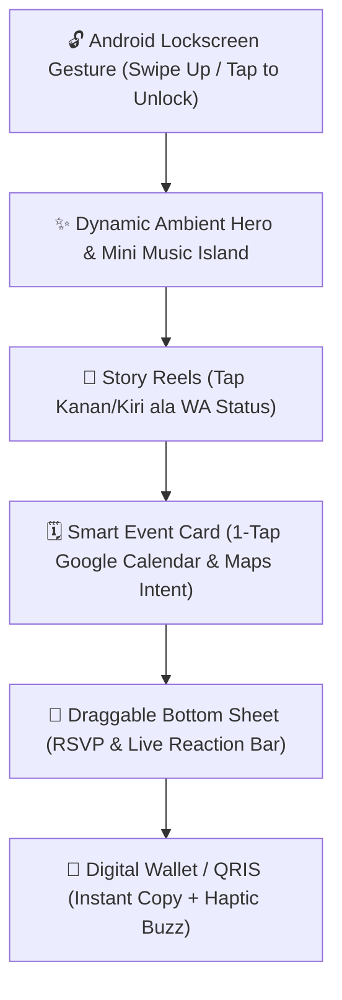

# 🚀 Blueprint Undangan Digital Rasa Native Android: Fresh, Interaktif & Bebas Kaku!

> **Konsep:** *"The Pocket Wedding App"* — Mengubah undangan web biasa menjadi pengalaman interaktif layaknya aplikasi Android modern (terinspirasi dari gestur Android, Material You, Story Reels, dan Spotify Wrapped).  
> **Vibe:** Segar, romantis, engaging, seru, dan sama sekali gak kaku!

---

## 📱 Kenapa Harus Relatable dengan Android?

Hampir **90% tamu undangan di Indonesia membuka link undangan lewat chat WhatsApp di smartphone Android**.  
Masalah terbesar undangan web jadul:
- ❌ Kaku seperti baca PDF/artikel berita yang cuma discroll ke bawah.
- ❌ Address bar Chrome/WhatsApp suka bikin tinggi layar lompat-lompat (*viewport bug*).
- ❌ Animasi berat bikin HP Android *entry-level* panas dan *lagging*.
- ❌ Teks kecil-kecil dan tombol susah dipencet dengan satu jempol (*thumb-unfriendly*).

**Solusinya?** Kita bikin undangan dengan nuansa **Mobile Micro-App**: responsif, respons gestur jempol lincah, ada getaran haptic saat tombol ditekan, dan visual yang *fun*!

---

## 🎨 1. Konsep Utama: *"Love Story OS"* (Bukan Undangan Kaku)

Lupakan konsep formal yang membosankan. Kita sulap halaman web menjadi antarmuka yang intim dan seru:



### Karakter Visual & Interaksi:
1. **Material You Aesthetic (Fluid & Rounded):** Sudut kartu membulat tebal (`rounded-3xl`), warna pastel adaptif, dan bayangan lembut (*soft ambient shadows*).
2. **Gesture-Driven:** Ada sensasi geser (*swipe*), tarik lembaran dari bawah (*draggable bottom sheet*), dan ketukan instan.
3. **Android Haptic Feedback:** Ponsel bergetar halus saat tamu menekan tombol penting (kirim doa, salin rekening, kirim reaksi).
4. **Floating Music Island:** Pemutar musik berbentuk kapsul melayang (*pill-shaped widget*) yang bisa di-minimize atau di-expand mirip media player Android notification shade.

---

## 🌈 2. Palet Warna & Visual Identity (Modern Warmth)

Nuansa yang hangat, elegan, tapi tetap santai dan *eye-catching*:

| Token Warna | Hex Code | Vibe & Fungsi di Android UI |
| :--- | :--- | :--- |
| **Sunset Glow** | `#FF6B81` | Tombol CTA utama, badge love, aksen floating action button |
| **Warm Oat (Base)** | `#FDFBF7` | Background utama; adem di mata, tidak bikin silau saat layar HP terang |
| **Soft Apricot** | `#FFE8D6` | Kartu sekunder, container chat/doa, background quote |
| **Matcha Sage** | `#7D9D8B` | Aksen pelengkap untuk agenda akad/lokasi yang bernuansa alam |
| **Midnight Espresso** | `#1E1B18` | Teks utama; kontras tinggi tapi lebih ramah mata dibanding hitam murni `#000` |
| **Android Status Bar** | `#FDFBF7` | Warna status bar HP via `<meta name="theme-color">` |

---

## 🕹️ 3. Bedah Pengalaman Interaktif per Sesi

### 3.1 Cover: "Swipe Up to Unlock Love"
* **Bosan dengan tombol "Buka Undangan" biasa?**
* **Konsep:** Tampilan awal menyerupai *lockscreen* elegan Android.
  - Nama tamu muncul personal: *"Halo Kak [Nama Tamu], you're invited!"*
  - Ada ikon gembok kecil bergetar lembut atau tanda panah mengambang ke atas.
  - **Interaksi:** Tamu cukup **swipe up (usap layar ke atas)** atau tap sekali untuk membuka gerbang undangan.
  - Saat terbuka: Muncul efek partikel cinta meletup (*haptic vibration 40ms*) dan lagu tema mulai mengalun lembut.

### 3.2 Floating Mini-Player: "Now Playing Our Journey"
* **Bentuk:** Kapsul mini melayang di pojok atas/bawah layar (mirip *Dynamic Island / Android Now Playing*).
* **Fitur Asik:**
  - Menampilkan judul lagu romantis + equalizer bergerak sesuai irama.
  - Bisa di-tap untuk jeda (*pause*) atau minimize jadi bulatan kecil agar tidak menghalangi bacaan.
  - Musik memudar halus (*volume fade*) otomatis saat tamu memutar video di galeri.

### 3.3 Kisah Cinta: "Instagram/WA Story Reels Mode"
* **Masalah:** Teks cerita cinta panjang bikin tamu malas baca.
* **Solusi Interaktif:**
  - Format kartu vertikal bergaya **Story / Status WhatsApp**.
  - Ada indikator garis progres di atas (bar 1, 2, 3, 4).
  - Tamu bisa **tap sebelah kanan** untuk next story, **tap sebelah kiri** untuk previous, atau **tekan & tahan (press-and-hold)** untuk pause dan melihat foto lebih detail!

### 3.4 Jadwal & Lokasi: "Android Smart Cards"
* **Bukan sekadar teks alamat!**
  - **Countdown Timer Widget:** Desain kotak waktu modern dengan countdown real-time.
  - **Deep-Link Google Maps:** Begitu tombol "Buka Peta" ditekan, langsung membuka **aplikasi Google Maps** bawaan HP (bukan web browser lemot), lengkap dengan rute navigasi.
  - **1-Tap Add to Calendar:** Langsung menambahkan jadwal akad & resepsi ke Google Calendar tamu lengkap dengan alarm pengingat H-1.

### 3.5 Interaksi Live: "Floating Emoji Reaction Bar"
* Layaknya fitur live streaming TikTok atau Instagram Reels:
  - Di pojok kanan bawah ada tombol ikon hati `❤️`, tepuk tangan `👏`, atau kembang api `🎉`.
  - Tamu bisa **spam tap** tombol reaksi tersebut! Setiap ketukan akan melontarkan animasi emoji melayang ke atas layar disertai efek getar jempol mikro.
  - Bikin tamu berasa ikut merayakan secara langsung walau membaca dari rumah.

### 3.6 Buku Tamu & RSVP: "Draggable Bottom Sheet"
* Daripada form panjang yang memakan tempat:
  - Tombol **"Kirim Doa & Kehadiran"** di bawah akan membuka panel lembaran yang meluncur mulus dari bawah layar (*Android Modal Bottom Sheet*).
  - Pilihan kehadiran berbentuk *Pill Chips* yang gampang ditekan jempol: `[🔥 Pasti Datang!]` `[🙏 Doa dari Jauh]` `[🤔 Masih Konfirmasi]`.
  - Setelah kirim: Muncul semburan confetti meriah + ucapan langsung masuk ke feed pesan berjalan.

### 3.7 Amplop Digital & Kado: "E-Wallet Style Card"
* **Tampilan:** Didesain mirip kartu dompet digital (kartu debit modern/BCA/Mandiri/GoPay).
* **Fitur Anti-Ribet:**
  - Nomor rekening tidak dipotong-potong.
  - Tombol **"Salin No. Rekening"** dilengkapi feedback visual "Tersalin! ✨" dan trigger getaran jempol.
  - Tombol **"Lihat QRIS"** menampilkan pop-up modal bersih yang bisa langsung di-screenshot atau di-scan tamu.

---

## 🛠️ 4. Android Optimization Hacks (Wajib Tahu!)

Ketika bikin undangan web untuk Android, trik teknis ini hukumnya wajib diterapkan:

### 4.1 Mengatasi Viewport Height Bug di Chrome Android
Di Chrome Android, tinggi layar `100vh` sering melar atau terpotong saat address bar muncul/hilang ketika digulir.
* **Solusi CSS Modern:** Gunakan `100dvh` (*dynamic viewport height*):
```css
.full-screen-section {
  min-height: 100vh;   /* Fallback untuk browser lama */
  min-height: 100dvh;  /* Wajib untuk Chrome/Firefox Android */
}
```

### 4.2 Warna Status Bar Menyatu (Seamless App Feel)
Biar browser Chrome Android terasa seperti aplikasi native tanpa garis pemisah yang kaku:
```html
<!-- Pasang di dalam tag <head> -->
<meta name="theme-color" content="#FDFBF7">
<meta name="apple-mobile-web-app-capable" content="yes">
<meta name="mobile-web-app-capable" content="yes">
```

### 4.3 WhatsApp In-App Browser Auto-Resume Audio
Browser bawaan WhatsApp di Android sering memblokir musik otomatis.  
* **Solusi UX:** Jadikan aksi pertama tamu (swipe/tap buka kunci) sebagai *user gesture unlock* untuk memicu `audio.play()` secara resmi tanpa kena blokir keamanan browser.

---

## 💻 5. Snippet Kode Penting Khas Android

### 5.1 Android Haptic Vibration Engine (Bikin Web Terasa Hidup!)
Jempol tamu akan merasakan getaran halus saat berinteraksi:

```javascript
// Utilitas getar khusus browser smartphone Android
const AndroidHaptics = {
  // Getaran halus untuk tap biasa (15 milidetik)
  tick: () => {
    if ('vibrate' in navigator) navigator.vibrate(15);
  },
  // Getaran sukses saat kirim doa / salin rekening
  success: () => {
    if ('vibrate' in navigator) navigator.vibrate([25, 40, 25]);
  },
  // Getaran seru saat spam tap tombol cinta
  pop: () => {
    if ('vibrate' in navigator) navigator.vibrate(30);
  }
};

// Contoh pasang di tombol salin:
document.getElementById('btnCopy').addEventListener('click', () => {
  AndroidHaptics.success();
  navigator.clipboard.writeText("1234567890");
  alert("Nomor rekening tersalin!");
});
```

---

### 5.2 Swipe Up to Unlock Gesture (Lockscreen Android)

```html
<div id="lockscreen" class="fixed inset-0 z-50 flex flex-col items-center justify-between p-8 bg-warm-oat transition-transform duration-500 ease-out">
  <div class="mt-12 text-center">
    <span class="text-xs uppercase tracking-widest text-gray-500 font-semibold">Special Invitation</span>
    <h1 class="text-3xl font-serif text-charcoal mt-2">Adam & Isna</h1>
    <p class="text-sm text-sunset-glow mt-1">Kepada Yth: Teman Terbaik</p>
  </div>

  <!-- Indikator Swipe Up Interaktif -->
  <div id="swipeArea" class="flex flex-col items-center cursor-pointer select-none">
    <div class="w-12 h-12 rounded-full bg-sunset-glow/10 flex items-center justify-center animate-bounce mb-2">
      <svg class="w-6 h-6 text-sunset-glow" fill="none" stroke="currentColor" viewBox="0 0 24 24">
        <path stroke-linecap="round" stroke-linejoin="round" stroke-width="2" d="M5 10l7-7m0 0l7 7m-7-7v18"/>
      </svg>
    </div>
    <span class="text-xs font-medium text-gray-400">Usap ke atas untuk membuka</span>
  </div>
</div>

<script>
  const lockscreen = document.getElementById('lockscreen');
  let startY = 0;

  // Tangkap gestur sentuhan layar HP
  lockscreen.addEventListener('touchstart', (e) => {
    startY = e.touches[0].clientY;
  }, { passive: true });

  lockscreen.addEventListener('touchend', (e) => {
    const endY = e.changedTouches[0].clientY;
    // Jika usapan ke atas lebih dari 60px atau tap
    if (startY - endY > 60 || Math.abs(startY - endY) < 10) {
      unlockInvitation();
    }
  }, { passive: true });

  function unlockInvitation() {
    AndroidHaptics.success();
    lockscreen.style.transform = 'translateY(-100%)';
    // Mulai putar musik tema di sini
  }
</script>
```

---

### 5.3 Deep Link Langsung ke Aplikasi Google Maps Android

Jangan pakai link web maps biasa yang membuka browser lagi. Gunakan format intent / universal link yang memicu aplikasi Maps Android langsung:

```html
<!-- Buka langsung aplikasi Google Maps di HP Android -->
<a 
  href="https://www.google.com/maps/dir/?api=1&destination=-6.2088,106.8456&travelmode=driving" 
  target="_blank" 
  rel="noopener"
  class="w-full py-3.5 px-6 rounded-2xl bg-gray-900 text-white font-medium text-center flex items-center justify-center gap-2 shadow-lg active:scale-95 transition-transform"
  onclick="AndroidHaptics.tick()"
>
  <svg class="w-5 h-5 text-sunset-glow" fill="currentColor" viewBox="0 0 24 24">
    <path d="M12 2C8.13 2 5 5.13 5 9c0 5.25 7 13 7 13s7-7.75 7-13c0-3.87-3.13-7-7-7zm0 9.5c-1.38 0-2.5-1.12-2.5-2.5s1.12-2.5 2.5-2.5 2.5 1.12 2.5 2.5-1.12 2.5-2.5 2.5z"/>
  </svg>
  Navigasi via Google Maps App
</a>
```

---

## 🎯 6. Checklist anti-Kaku Sebelum Share ke WhatsApp

- [ ] **Uji Pakai Satu Jempol:** Coba pegang HP dengan satu tangan, pastikan semua tombol penting terjangkau jempol bawah (*Bottom Thumb Zone*).
- [ ] **Buka Lewat Chat WhatsApp Langsung:** Jangan cuma tes di Chrome desktop. Kirim link ke WhatsApp sendiri, buka langsung di *in-app browser* WA Android untuk memastikan musik dan pop-up lancar.
- [ ] **Cek di HP Android Ram 3/4GB:** Pastikan tidak ada animasi berat yang membuat browser *stutter* atau *force reload*.
- [ ] **Pastikan Tombol Back HP Aman:** Jika membuka modal foto atau bottom sheet doa, pastikan tombol *Back* Android tidak langsung melempar tamu keluar dari website.

---

Dengan konsep ini, undangan pernikahan Anda bukan lagi halaman statis yang kaku, melainkan sebuah **pengalaman digital seru, estetik, dan berkesan yang bikin tamu betah berlama-lama menikmatinya di smartphone mereka!** 🎉✨
